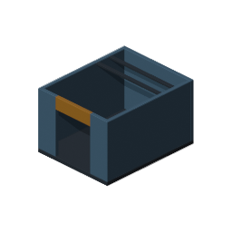
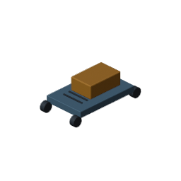
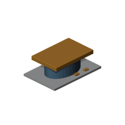
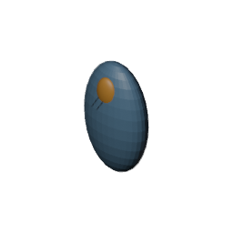
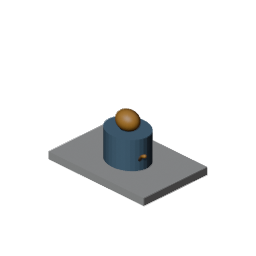
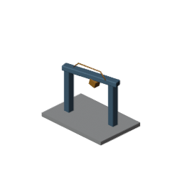

# Phase 12 technical completion and visual review

The v7 Phase 12 technical hard exit is complete for the tested Blender 5.2.2 /
Unity 6000.6.3f1 workflow. Same-host code review approved the scoped changes;
security/publication review accepted them with no blocking findings. Neither
review substitutes for a human's artistic decision or the evaluator-owned
Phase 13 comparison.

The source blueprint's Section 7.4 requires the asymmetric socket to pass in
Unity, an injected reflection to fail, source/metadata integrity and compatible
regressions. It explicitly keeps artistic quality at a separate REVIEW. The
unseen equal-tool trial is Section 7.5, Phase 13. Earlier PARTIAL wording grouped
these separate gates; the completed technical exit does not authorize Phase 13.

Code review checked the exporter, independent source metrics, native import
probe, trace helper and assisted-router dependency slice. It verified all five
indexed code hashes and 120 original evidence files, and independently read the
12-import, ten-mutant, 24-parent and six-rollback receipts. Fresh focused review
checks passed Ruff, strict typing, C# syntax and 32 affected Python tests.
Security review found no credential candidates in the published evidence and
verified the original project's 245-file inventory was unchanged.

Two independent canonical wheel/sdist builds also matched byte for byte.
[Build receipt](phase-12-v7-evidence/publish-builds.json).

## Visual observations for the owner

A separate visual review inspected all six isometric renders and seven relevant
orthographic renders. All 13 were nonblank and fully framed; no fatal render
blocker was observed. The table records visible limitations rather than granting
artistic approval.

| Case | Observations | Disposition |
| --- | --- | --- |
| Room kit | Floor, perimeter walls, doorway, lintel and ceiling beams visible | Technical render PASS; artistic REVIEW |
| Vehicle | Cabin seated on chassis: both contact planes 1.00 m; cabin top 2.00 m | Corrected native iso/front/side views checked; artistic REVIEW |
| Mechanical prop | Base, housing, cap and mounts visible; cap occludes the bore | Geometry is checked numerically; visual bore acceptance unproven |
| Organic practice | Orange crown and two dark ridge segments visible in front/isometric views | Corrected native views checked; crown occludes portions of ridges; artistic REVIEW |
| Coolant composition | Base, housing, handle and a short exposed pipe end visible; handle obscures bore | Numerical Boolean/socket checks pass; artistic REVIEW |
| Inspection gantry | Deck, posts, crossbeam, conduit and suspended inspection head visible | Technical render PASS; artistic REVIEW |

The owner requested correction of the floating cabin and hidden organic detail.
Twenty-one regression cases failed on the old plans; all 101 modeling tests then
passed. The cabin uses a 0.5h height and 0.75h center. Crown placement and
17-point editable ridge paths expose detail without enlarging the envelope.
A second visual review inspected six new native views and confirmed the two
requested outcomes, with no obvious detachment in this cohort. Before/after
plans and images are retained in the evidence directory.

Limit: ideal ellipsoid paths do not prove continuous contact against faceted
main/LOD surfaces at extreme aspect ratios. Native visual evidence covers
vehicle 3 × 2 × 6 m and organic 2 × 3 × 1 m. Extreme-ratio ridge attachment
remains unqualified. No human artistic approval is inferred from model review.








## Publication scope

Publish the Phase 12 repair, its router/data/test dependencies, v7 source plan,
current documentation and new exact-byte evidence on `codex/polyforge-phase-12`.
Keep the unrelated video/court work, old blueprint deletion and earlier native
artifact regenerations outside this commit. Preserve the latter in the working
tree. Use a pull request for integration; no stable tag or direct main merge.

This report is prepared before committing. Its containing commit is the source
identity; GitHub's branch/PR checks provide the actual remote publication and CI
status. The earlier native execution helpers require their recorded ignored
workspaces. A fresh checkout should use the canonical tests instead:

```powershell
.\.venv\Scripts\python.exe -m pytest tests/test_phase12_native.py -m "blender or unity"
```

Native tests require the pinned installed applications and their declared
dependencies. Missing tools remain failures/blocks, never passing evidence.
